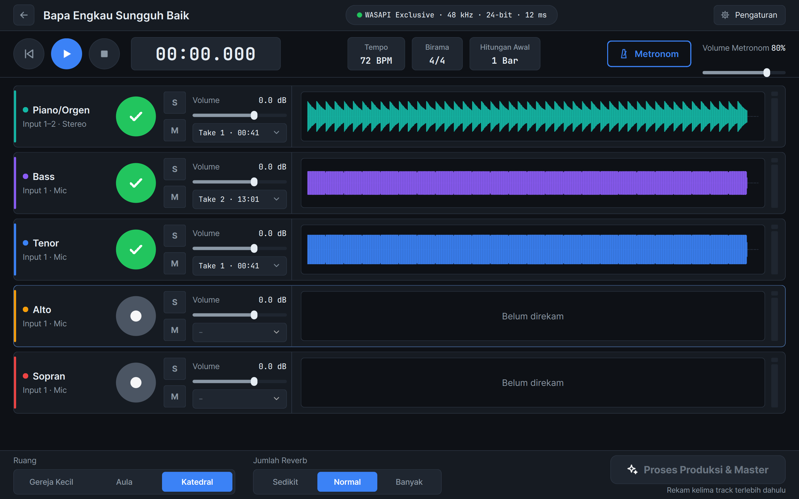
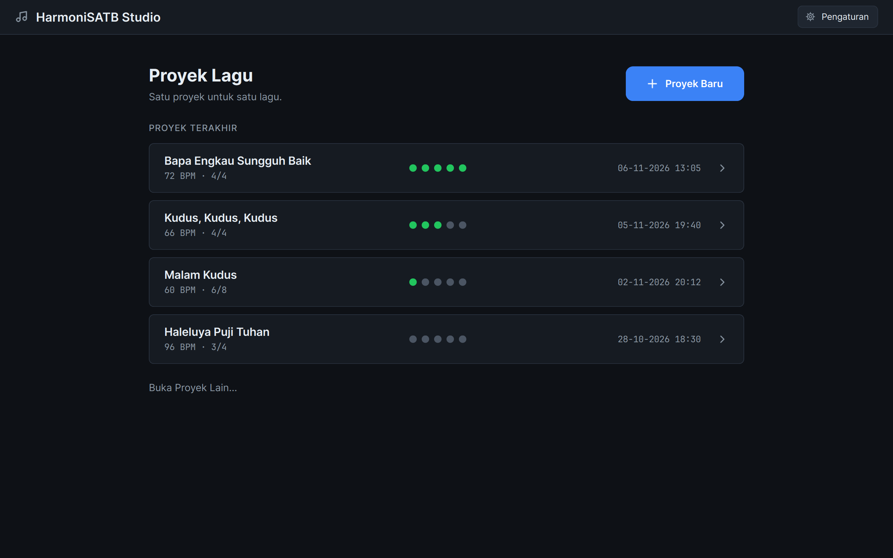
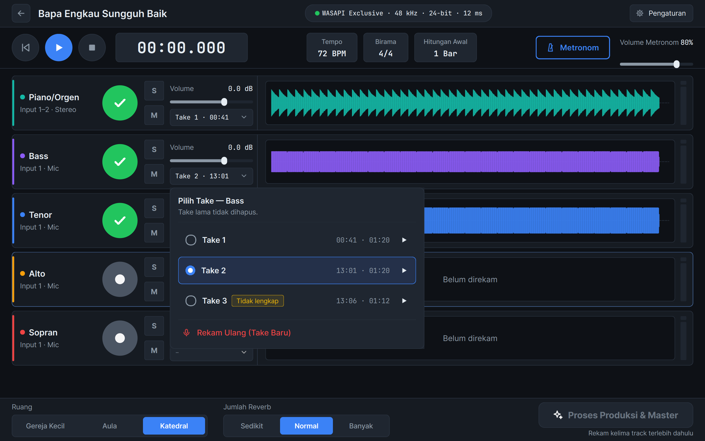
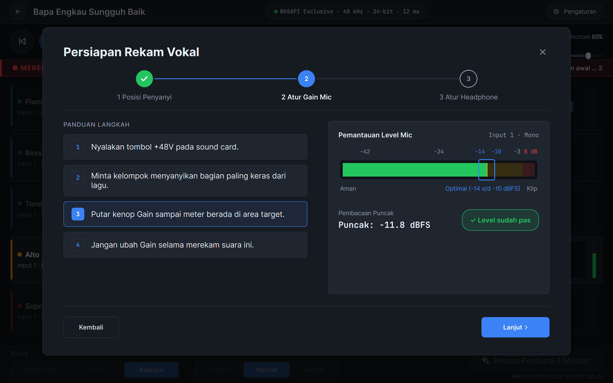
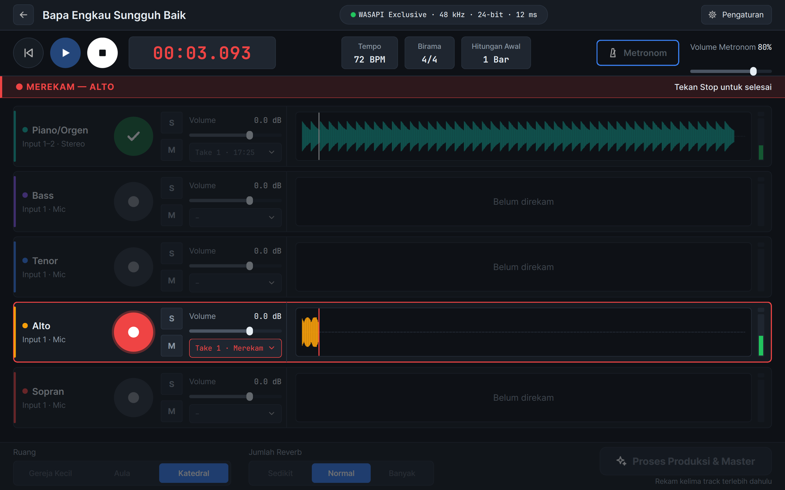
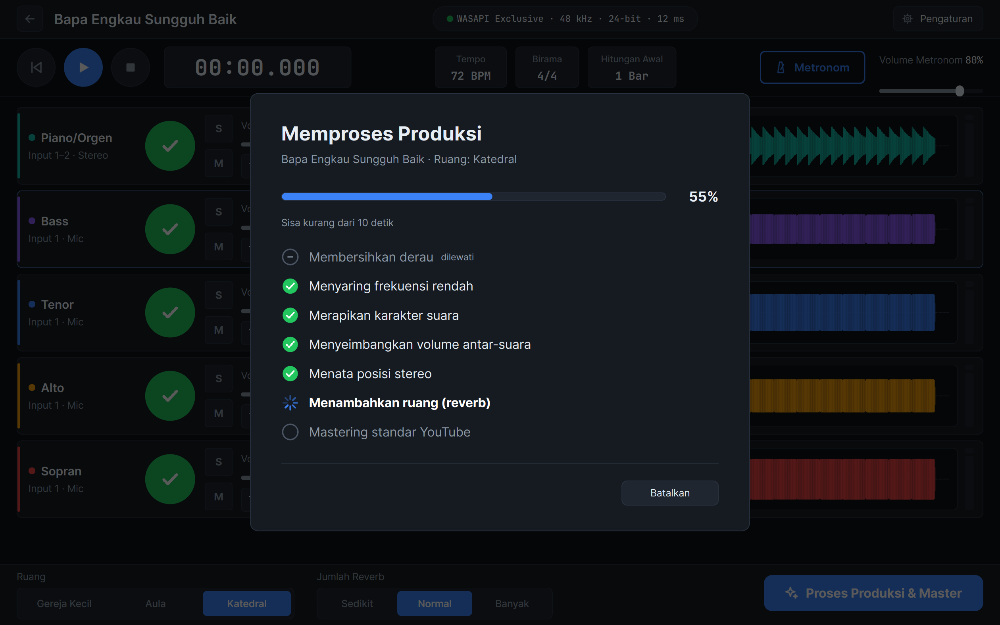
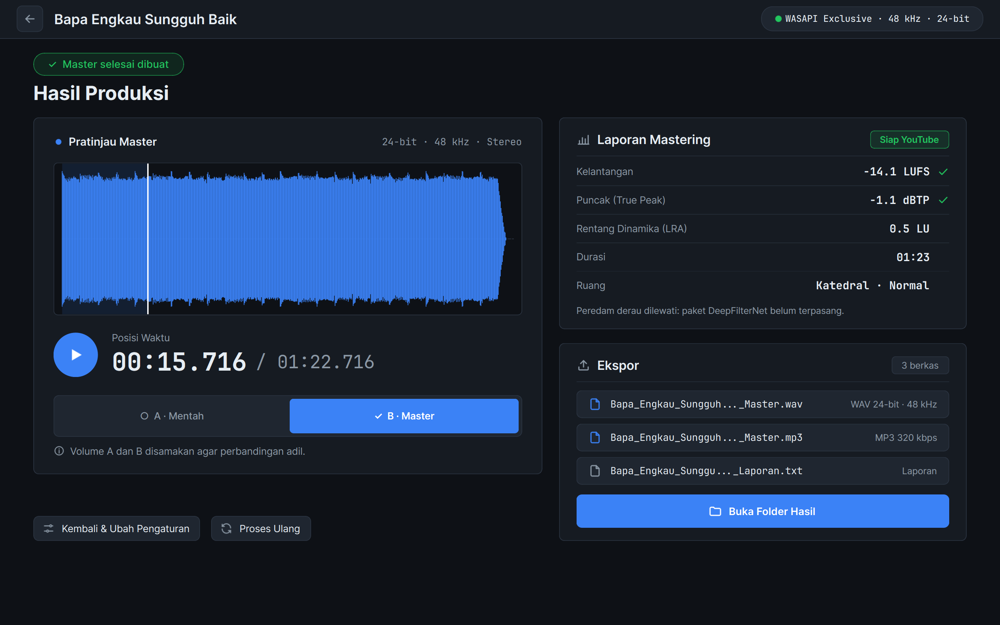

<div align="center">


# HarmoniSATB Studio

**Rekam paduan suara SATB dan piano secara bergiliran, lalu buat master siap YouTube dengan satu klik.**


-41cd52)


[Fitur](#fitur) ·
[Tangkapan layar](#tangkapan-layar) ·
[Instalasi](#instalasi) ·
[Pengembangan](#pengembangan) ·
[Dokumentasi](#dokumentasi) ·
[Status](#status-proyek)



</div>

---

## Daftar isi

- [Tentang](#tentang)
- [Fitur](#fitur)
- [Tangkapan layar](#tangkapan-layar)
- [Cara kerja](#cara-kerja)
- [Kebutuhan sistem](#kebutuhan-sistem)
- [Instalasi](#instalasi)
- [Mulai cepat](#mulai-cepat)
- [Pengembangan](#pengembangan)
- [Alat baris perintah](#alat-baris-perintah)
- [Struktur repositori](#struktur-repositori)
- [Dokumentasi](#dokumentasi)
- [Status proyek](#status-proyek)
- [Batasan yang diketahui](#batasan-yang-diketahui)
- [Berkontribusi](#berkontribusi)
- [Hak cipta dan komponen pihak ketiga](#hak-cipta-dan-komponen-pihak-ketiga)
- [Ucapan terima kasih](#ucapan-terima-kasih)

## Tentang

HarmoniSATB Studio (nama repositori: ChoraleStudio) adalah aplikasi desktop Windows untuk paduan suara gereja, komunitas vokal, dan sekolah yang tidak punya studio maupun teknisi audio.

Dengan satu sound card USB, satu mikrofon, dan beberapa headphone, paduan suara merekam lima track secara bergiliran (overdub): piano lebih dulu sebagai panduan, lalu Bass, Tenor, Alto, dan Sopran. Setelah semua terekam, tombol **Proses Produksi & Master** menjalankan seluruh pengolahan audio dan menghasilkan:

| Berkas | Format |
|---|---|
| `<Judul>_<tanggal-jam>_Master.wav` | PCM 24-bit, 48 kHz, stereo, dither TPDF |
| `<Judul>_<tanggal-jam>_Master.mp3` | 320 kbps CBR dengan tag judul |
| `<Judul>_<tanggal-jam>_Laporan.txt` | Laporan mastering berbahasa Indonesia |

Hasilnya memenuhi standar YouTube: **True Peak ≤ -1,0 dBTP** dan kelantangan **-14 LUFS ±1**, diukur menurut ITU-R BS.1770-4 / EBU R128 dan diverifikasi ulang dengan FFmpeg.

Spesifikasi lengkap ada di [docs/PRD_v1.1.md](docs/PRD_v1.1.md).

## Fitur

**Perekaman**

- Lima track tetap: Piano/Orgen (stereo) dan empat suara vokal (mono), masing-masing dengan Solo, Mute, volume -12 sampai +6 dB, dan daftar take.
- Rekam ulang tidak pernah menghapus take lama; take aktif dipilih dari daftar.
- Metronom 40 sampai 240 BPM, birama 2/4, 3/4, 4/4, 6/8, hitungan awal 0 sampai 2 bar. Bunyinya hanya ke headphone dan tidak ikut terekam.
- Kalibrasi latensi sekali per sound card; rekaman baru otomatis sejajar sampel demi sampel dengan track sebelumnya.
- Meter level hijau, kuning, merah, dengan lampu clip yang tetap menyala sampai diklik.
- Panduan **Persiapan Rekam Vokal** tiga langkah: posisi penyanyi, gain mikrofon, dan headphone.

**Keandalan**

- Callback audio hanya menyalin ke ring buffer; thread terpisah menulis WAV 24-bit ke disk dan memperbarui header setiap detik. Bila listrik padam, paling banyak 1 detik hilang.
- Sound card yang tercabut saat merekam tidak membuat rekaman hilang. Pengguna diberi tahu sampai detik ke berapa audio tersimpan.
- Peringatan sebelum merekam bila ruang disk kurang dari 2 GB, dan petunjuk perbaikan bila sound card tidak berjalan di 48 kHz.
- Log berotasi di `%APPDATA%\HarmoniSATB\logs\`; pengguna hanya melihat pesan ramah, bukan traceback.

**Pascaproduksi dan mastering**

- Rantai tujuh tahap otomatis: peredam derau (opsional), penyaring frekuensi rendah, EQ dan kompresor, penyeimbang volume antar-suara, posisi stereo, reverb, dan mastering.
- Tiga ruang (Gereja Kecil, Aula, Katedral) dengan jumlah reverb Sedikit, Normal, atau Banyak.
- Limiter True Peak dengan oversampling 4 kali dan prioritas target yang jelas: True Peak > LUFS > LRA.
- Pemutar **Mentah vs Master** dengan kelantangan disamakan untuk perbandingan yang adil.
- Proses ulang kapan saja tanpa merekam ulang; ekspor tidak pernah menimpa berkas lama.

**Distribusi**

- Satu `Setup.exe` (87 MB) tanpa perlu memasang Python, tanpa hak admin, dengan shortcut Start Menu dan Desktop.
- Sepenuhnya offline. Tidak ada kode jaringan di aplikasi.
- Mesin pengolah dapat dijalankan dari baris perintah tanpa antarmuka.

## Tangkapan layar

| | |
|---|---|
| <br>**Daftar proyek** | <br>**Memilih take** |
| <br>**Persiapan Rekam Vokal** | <br>**Sound card tercabut saat merekam** |
| <br>**Memproses Produksi** | <br>**Hasil Produksi** |

Semua tangkapan layar ada di [docs/screenshots/](docs/screenshots/), dan mockup desain acuannya di [design/](design/).

## Cara kerja

```text
 Rekam (overdub)                  Pascaproduksi per track                       Bus master
 ───────────────                  ────────────────────────                      ──────────
 Piano  ─┐                        1 Peredam derau (opsional)                    Kompresor bus 1,5:1
 Bass   ─┤   take aktif           2 High-pass 35/75/90 Hz                       Limiter True Peak 4x
 Tenor  ─┼─────────────────────►  3 EQ -2 dB @400 Hz + kompresor 2,5:1  ──► mix ─► -14 LUFS, ≤ -1 dBTP
 Alto   ─┤                        4 Seimbangkan ke -23 LUFS (piano -25)          │
 Sopran ─┘                        5 Pan constant-power                           ▼
                                  6 Reverb konvolusi (Gereja Kecil/Aula/Katedral)  WAV + MP3 + Laporan
```

Penjelasan teknis lengkap (model thread, kompensasi latensi, algoritma limiter, format proyek) ada di [docs/ARCHITECTURE.md](docs/ARCHITECTURE.md).

## Kebutuhan sistem

| Komponen | Minimum | Catatan |
|---|---|---|
| Sistem operasi | Windows 10 atau 11, 64-bit | |
| CPU | Quad-core 2,5 GHz | Diuji di Intel Core i5-13500H |
| RAM | 8 GB | |
| Disk | 2 GB kosong untuk rekaman | SSD disarankan |
| Sound card | USB, mendukung 48 kHz / 24-bit | Dirancang untuk SPL Audio SC202HD |
| Mikrofon | Condenser large-diaphragm, phantom +48V | Satu mikrofon untuk 2 sampai 4 penyanyi |
| Headphone | Closed-back, satu per penyanyi aktif | Lewat headphone splitter atau amplifier |

Prioritas driver: **ASIO** (bila tersedia) → **WASAPI Exclusive** → **WASAPI Shared**. Suara penyanyi sendiri tidak diputar ulang oleh aplikasi; penyanyi mendengarnya lewat tombol direct monitor di sound card.

## Instalasi

### Untuk pengguna

Rilis unduhan belum diterbitkan. Sampai saat itu, `Setup.exe` dibuat dari kode sumber (lihat [Membuat installer](#membuat-installer)), lalu:

1. Jalankan `HarmoniSATB-Studio-1.1.0-Setup.exe` dan ikuti langkahnya. Hak admin tidak diperlukan.
2. Buka **HarmoniSATB Studio** dari Start Menu atau Desktop.
3. Peluncuran pertama bisa 20 sampai 50 detik karena Windows Defender memindai berkas baru.

Uninstall lewat *Settings > Apps*. Pengaturan di `%APPDATA%\HarmoniSATB` dan folder proyek Anda tidak ikut terhapus.

Panduan bergambar dari instalasi sampai ekspor: [docs/PANDUAN_PENGGUNA.md](docs/PANDUAN_PENGGUNA.md).

### Dari kode sumber

Butuh Python 3.12 (cek dengan `py -0`). Path proyek boleh mengandung spasi; selalu beri tanda kutip.

```powershell
git clone https://github.com/dimasarturoh15/ChoraleStudio.git
cd ChoraleStudio
py -3.12 -m venv .venv
.venv\Scripts\python -m pip install --upgrade pip
.venv\Scripts\python -m pip install -r requirements.txt
.venv\Scripts\python -m pip install -e .
.venv\Scripts\python -m chorale
```

## Mulai cepat

1. **Proyek Baru**: isi judul lagu, tempo, birama, dan hitungan awal.
2. **Pengaturan > Perangkat Audio**: pilih sound card, lalu jalankan **Kalibrasi Latensi** sekali (butuh kabel dari output ke input sound card).
3. **Rekam Piano** sebagai panduan.
4. **Rekam vokal** berurutan Bass, Tenor, Alto, Sopran. Nyalakan tombol direct monitor di sound card agar penyanyi mendengar suaranya sendiri.
5. Pilih take terbaik di setiap track, lalu tekan **Proses Produksi & Master**.
6. Bandingkan **Mentah** dan **Master**, lalu buka folder hasil.

Untuk memastikan aplikasi hasil instalasi sehat tanpa sound card:

```powershell
"HarmoniSATB Studio.exe" --uji-mandiri
```

Perintah ini memproses lima track sintetis sampai WAV, MP3, dan laporan, lalu keluar dengan kode `0` bila lulus. Hasilnya dicatat di log.

## Pengembangan

### Menjalankan tes

```powershell
.venv\Scripts\python -m pytest -q
```

Seluruh 241 tes berjalan tanpa sound card (antarmuka diuji dengan `QT_QPA_PLATFORM=offscreen`) dalam sekitar 1,5 menit. Uji yang membutuhkan perangkat nyata ada sebagai skrip di `tools/`.

### Aturan teknis

Aturan wajib proyek ada di [CLAUDE.md](CLAUDE.md), ringkasnya:

- Sample rate dikunci 48 000 Hz, rekaman 24-bit, pemrosesan internal float32.
- Callback audio tidak boleh mengalokasi memori besar, mengakses disk, menulis log, atau menyentuh objek Qt.
- Nama variabel, fungsi, dan kelas dalam bahasa Inggris; komentar, docstring, dan teks antarmuka dalam Bahasa Indonesia.
- Tidak ada fitur di luar PRD (misalnya koreksi nada, punch-in, atau plug-in VST).

Panduan kontribusi lengkap: [CONTRIBUTING.md](CONTRIBUTING.md).

### Membuat installer

Butuh [Inno Setup 6](https://jrsoftware.org/isdl.php) (`winget install --id JRSoftware.InnoSetup -e`).

```powershell
.venv\Scripts\python -m pip install -r requirements-build.txt
.venv\Scripts\python tools\build_installer.py
```

| Hasil | Lokasi |
|---|---|
| Aplikasi siap jalan (PyInstaller onedir, 328 MB) dan teks lisensi pihak ketiga | `dist\HarmoniSATB Studio\` |
| Installer (87 MB) | `installer\Output\HarmoniSATB-Studio-<versi>-Setup.exe` |

Skrip build juga menjalankan aplikasi hasil build dengan PATH tanpa Python, termasuk `--uji-mandiri`. Gunakan `--lewati-installer` untuk berhenti setelah PyInstaller.

## Alat baris perintah

Semua alat dijalankan dengan `.venv\Scripts\python tools\<nama>.py`. Referensi lengkap beserta opsinya ada di [docs/CLI.md](docs/CLI.md).

| Alat | Kegunaan |
|---|---|
| `list_devices.py` | Daftar host API dan perangkat audio, menandai SC202HD dan dukungan ASIO |
| `test_wasapi.py` | Membuka sound card di WASAPI Exclusive (lalu Shared), 48 kHz, buffer 256 |
| `calibrate_latency.py` | Mengukur latensi rekam-putar dengan kabel loopback |
| `sync_test.py` | Uji selisih antar-track lewat loopback (target ≤ 3 ms) |
| `stress_test.py` | Rekam dan putar selama N menit, menghitung dropout |
| `cli_session.py` | Membuat proyek, merekam, memutar, dan memilih take tanpa antarmuka |
| `import_takes.py` | Mengimpor WAV/FLAC sebagai take |
| `make_demo_project.py` | Membuat proyek contoh berisi lima track sintetis |
| `process_project.py` | Memproses proyek menjadi WAV, MP3, dan laporan |
| `benchmark.py` | Mengukur waktu proses lagu 4 menit (target ≤ 60 detik) |
| `ui_screenshots.py` | Mengambil tangkapan layar setiap layar |
| `build_installer.py` | Membuat aplikasi PyInstaller dan Setup.exe |

## Struktur repositori

```text
ChoraleStudio/
├── src/chorale/
│   ├── audio/        Engine real-time: perangkat, sesi, perekam, pemutar, metronom, meter, kalibrasi
│   ├── project/      Model proyek dan take, simpan/buka, proyek terakhir
│   ├── dsp/          Rantai pascaproduksi, mastering, pengukuran, ekspor, produce()
│   ├── ui/           Antarmuka PySide6, tema, font, ikon
│   ├── licenses.py   Daftar komponen pihak ketiga untuk halaman Tentang
│   ├── logging_setup.py  Log berotasi dan penangkap error
│   └── selftest.py   Uji mandiri --uji-mandiri
├── tools/            Skrip uji hardware, benchmark, CLI, dan build
├── tests/            Tes pytest
├── installer/        Spesifikasi PyInstaller, skrip Inno Setup, peluncur
├── design/           Mockup UI acuan
└── docs/             PRD, arsitektur, CLI, panduan pengguna, uji lapangan, progres
```

## Dokumentasi

| Dokumen | Isi |
|---|---|
| [docs/PRD_v1.1.md](docs/PRD_v1.1.md) | Spesifikasi produk: kebutuhan fungsional, non-fungsional, kriteria penerimaan |
| [docs/ARCHITECTURE.md](docs/ARCHITECTURE.md) | Arsitektur, model thread, DSP, format berkas |
| [docs/CLI.md](docs/CLI.md) | Referensi semua alat baris perintah |
| [docs/PANDUAN_PENGGUNA.md](docs/PANDUAN_PENGGUNA.md) | Panduan bergambar untuk pengguna |
| [docs/UJI_LAPANGAN.md](docs/UJI_LAPANGAN.md) | Checklist uji bersama paduan suara |
| [docs/PROGRESS.md](docs/PROGRESS.md) | Catatan pengerjaan per segmen, hasil tes, keputusan teknis |
| [CHANGELOG.md](CHANGELOG.md) | Riwayat perubahan per versi |
| [CONTRIBUTING.md](CONTRIBUTING.md) | Cara berkontribusi |
| [SECURITY.md](SECURITY.md) | Cara melaporkan masalah keamanan |
| [THIRD_PARTY_NOTICES.md](THIRD_PARTY_NOTICES.md) | Komponen pihak ketiga dan lisensinya |

## Status proyek

Versi **1.1.0** lengkap secara fitur dan siap uji lapangan. Ringkasan kriteria penerimaan (PRD bagian 10):

| Kriteria | Target | Status |
|---|---|---|
| Standar YouTube | True Peak ≤ -1,0 dBTP pada 100% berkas uji | ✅ Lulus |
| Kecepatan | Lagu 4 menit, 5 track ≤ 60 detik | ✅ Lulus (34,4 detik) |
| Ekspor | WAV 24/48 dan MP3 320 valid, ekor utuh, tidak menimpa | ✅ Lulus |
| Stabilitas audio | 0 dropout selama 60 menit pada buffer 256 | ✅ Lulus di Realtek · ⏳ SC202HD |
| Keamanan rekaman | ≤ 1 detik hilang bila listrik padam | ✅ Lulus (simulasi) |
| Instalasi | Satu Setup.exe tanpa Python, ≤ 1,5 GB | ✅ Lulus (87 MB) |
| Offline | Semua fitur tanpa internet | ✅ Lulus (desain) |
| Sinkronisasi | Selisih antar-track ≤ 3 ms | ⚠️ Tidak konsisten di SC202HD: 1,3 sampai 5,8 ms antar-sesi (lihat PROGRESS) |
| Kualitas vokal | Tanpa artefak denoise dan comb-filtering | ⏳ Butuh rekaman nyanyian asli |
| Kegunaan | Anggota baru menyelesaikan satu lagu | ⏳ Uji lapangan |

Detail bukti setiap kriteria ada di [docs/PROGRESS.md](docs/PROGRESS.md).

## Batasan yang diketahui

- Uji dengan SPL Audio SC202HD (kalibrasi, sinkronisasi, stress test, rekaman nyanyian) belum dilakukan; uji stabilitas sejauh ini memakai sound card Realtek bawaan laptop.
- Peredam derau DeepFilterNet belum dipakai sampai diuji dengan rekaman nyanyian asli.
- Tidak ada koreksi nada; nada meleset diatasi dengan merekam ulang.
- SC202HD hanya punya tombol direct monitor ON/OFF, sehingga keseimbangan suara sendiri dan musik di headphone tidak dapat diatur halus di perangkat.
- Hanya untuk Windows.

## Berkontribusi

Laporan bug dan saran sangat diterima lewat [Issues](https://github.com/dimasarturoh15/ChoraleStudio/issues). Baca [CONTRIBUTING.md](CONTRIBUTING.md) sebelum mengirim pull request. Fitur baru hanya diterima bila tercantum di PRD.

## Hak cipta dan komponen pihak ketiga

Hak cipta © 2026 Dimas Arturoh. Repositori ini belum memiliki lisensi open-source; kode dapat dilihat dan dipelajari, tetapi tidak diberi izin untuk disalin, diubah, atau didistribusikan tanpa persetujuan pemilik.

Aplikasi memakai komponen pihak ketiga dengan lisensinya masing-masing, antara lain PySide6 (LGPL v3), pedalboard (GPL v3), dan FFmpeg (GPL v3). Daftar lengkap ada di [THIRD_PARTY_NOTICES.md](THIRD_PARTY_NOTICES.md), dan teks lisensinya disertakan di folder `licenses\` hasil instalasi.

## Ucapan terima kasih

- [Choral Singing Dataset](https://zenodo.org/record/2649950) (Universitat Pompeu Fabra, CC BY-NC 4.0), dipakai sebagai bahan uji rekaman paduan suara asli.
- Tim pengembang PortAudio, sounddevice, pedalboard, pyloudnorm, FFmpeg, dan Qt for Python.
- Font [Inter](https://rsms.me/inter/) dan [JetBrains Mono](https://www.jetbrains.com/lp/mono/).
