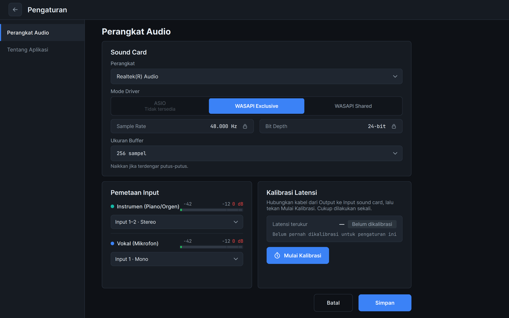
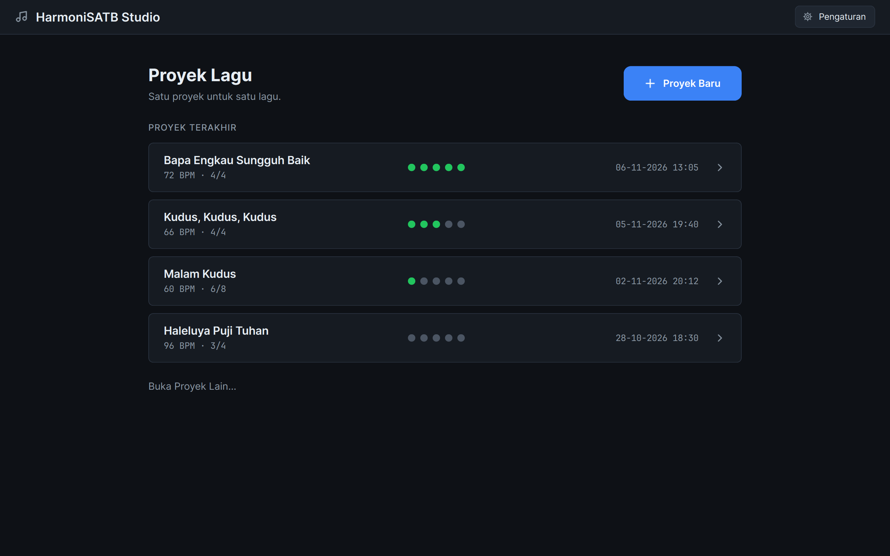
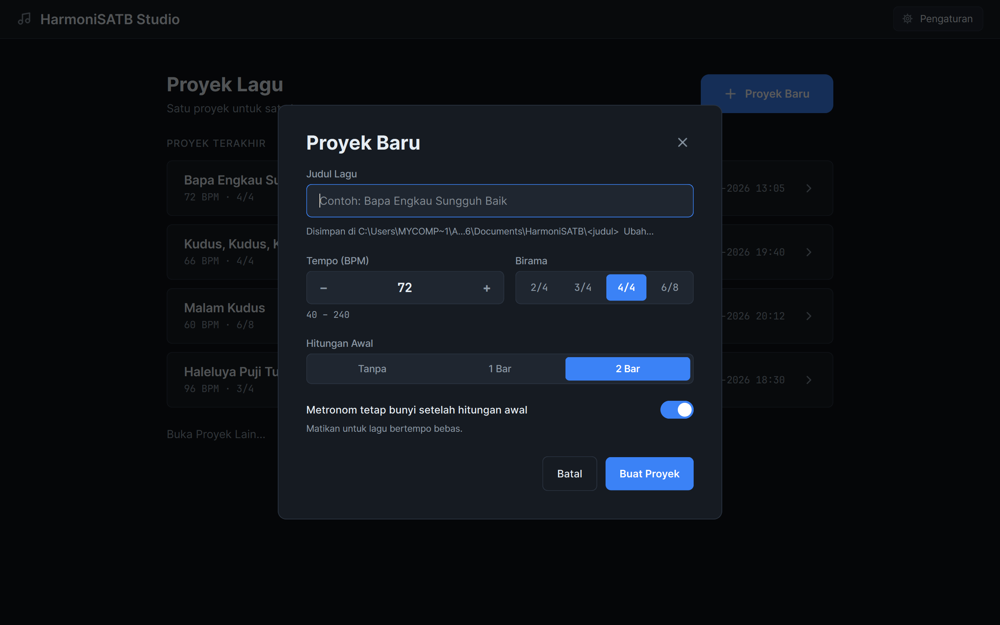
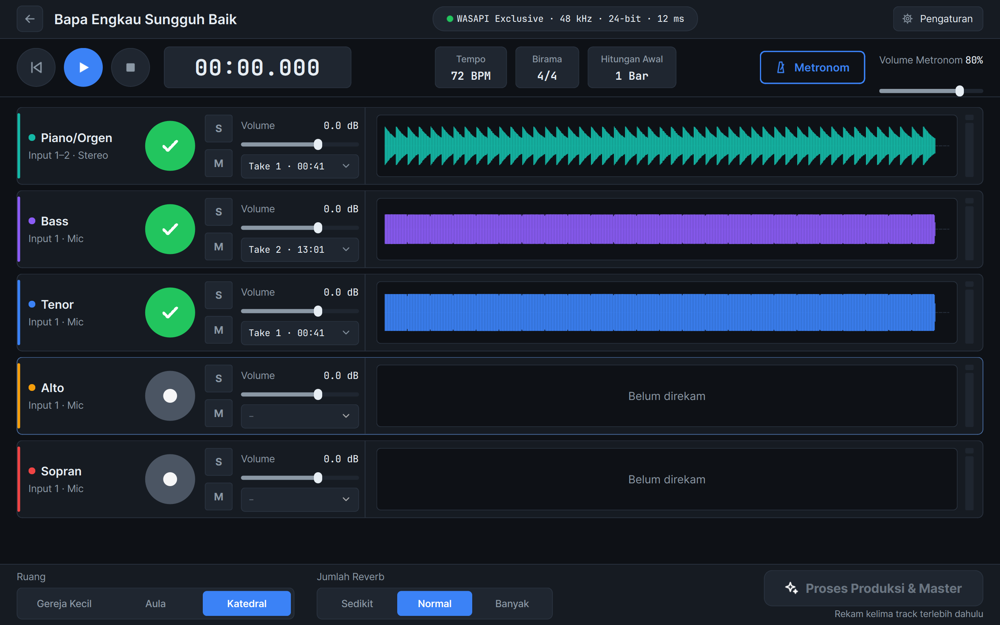
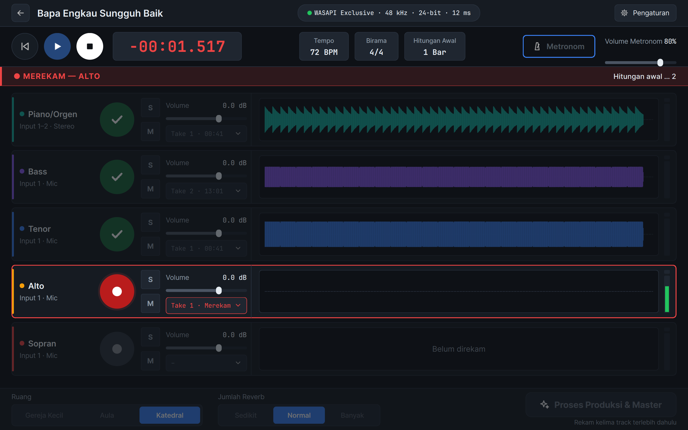
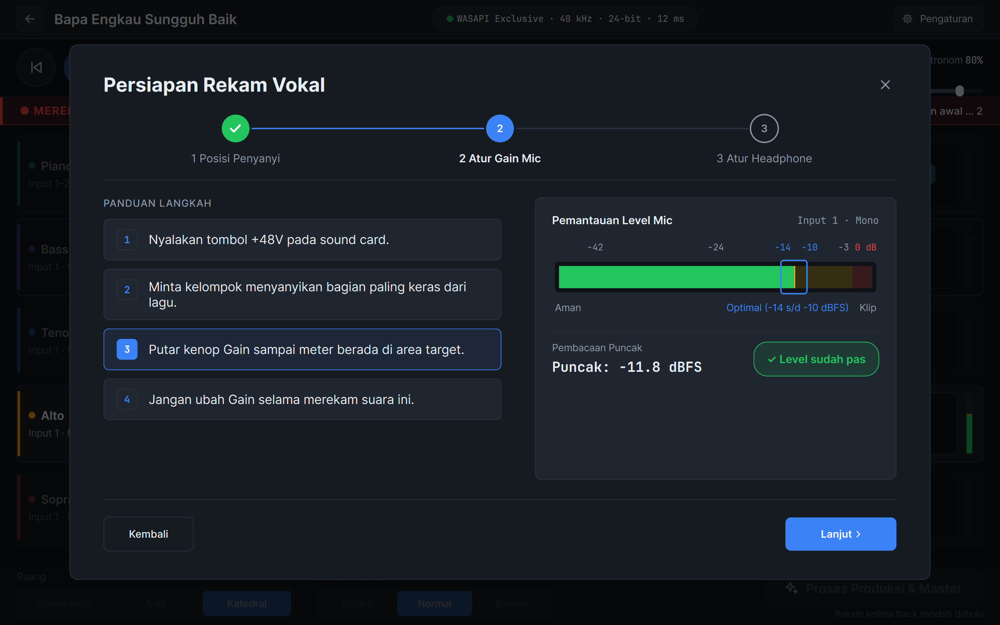
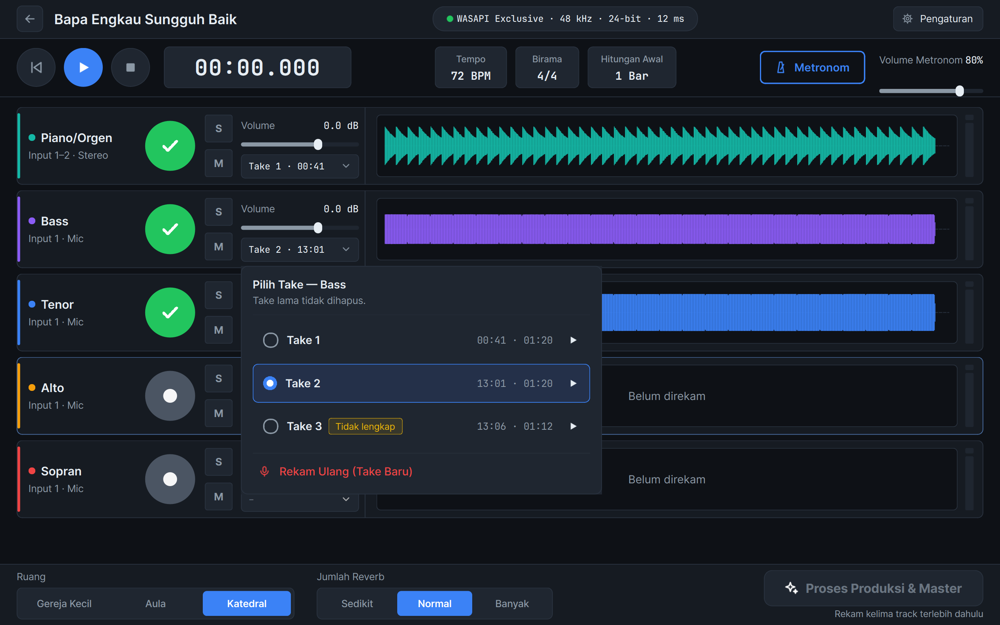
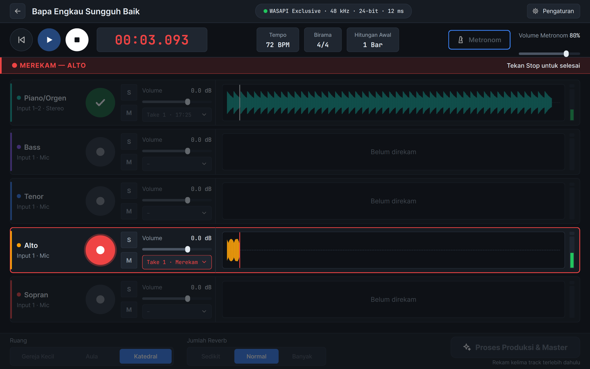
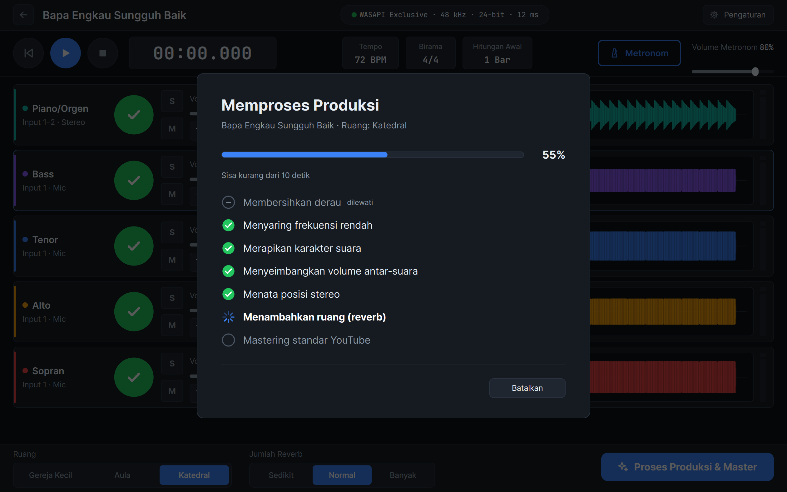
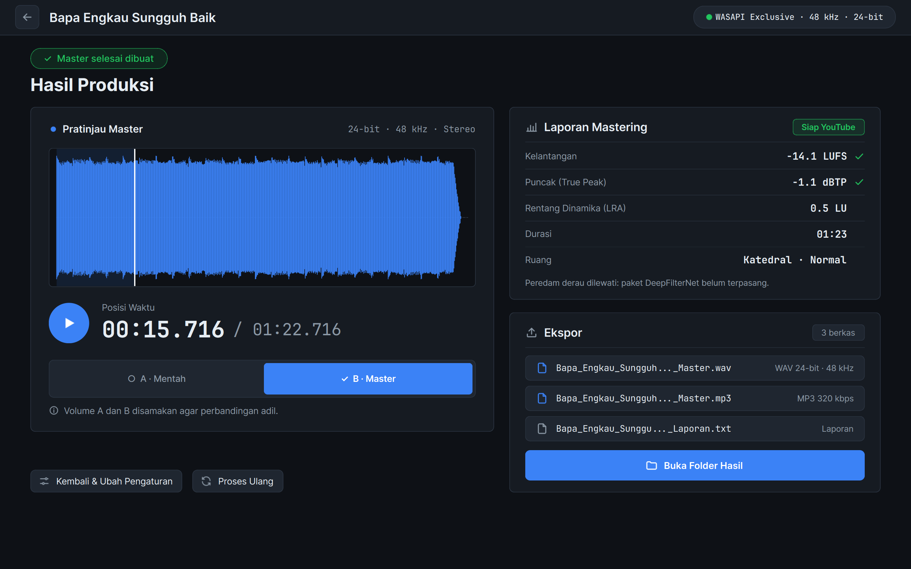

# Panduan Pengguna HarmoniSATB Studio

HarmoniSATB Studio membantu paduan suara merekam **piano/orgen** lalu **Bass, Tenor, Alto, dan Sopran** secara bergiliran, kemudian membuat file **siap YouTube** dengan satu tombol.

> Gambar di panduan ini memakai contoh lagu buatan komputer. Tampilan di laptop Anda bisa sedikit berbeda (misalnya nama sound card).

---

## 1. Memasang aplikasi

1. Klik dua kali **HarmoniSATB-Studio-1.1.0-Setup.exe**.
2. Ikuti langkah di layar. Centang **"Buat shortcut di Desktop"** jika ingin ikon di Desktop.
3. Setelah selesai, buka **HarmoniSATB Studio** dari Start Menu atau Desktop.

Tidak perlu memasang program lain dan tidak perlu internet.

**Menghapus aplikasi:** Pengaturan Windows → Aplikasi → HarmoniSATB Studio → Uninstall. Proyek dan rekaman Anda **tidak ikut terhapus**.

---

## 2. Pertama kali: atur sound card

**Setiap kali akan merekam, siapkan laptop dulu.** Sound card USB seperti SC202HD mudah terganggu oleh pengaturan hemat daya Windows:

1. **Colokkan charger laptop.** Jangan merekam memakai baterai.
2. **Matikan aplikasi pengolah suara** seperti FxSound, Nahimic, atau Dolby: klik kanan ikonnya di pojok kanan bawah, lalu pilih **Exit/Keluar**.
3. **Matikan USB selective suspend** (cukup sekali): Control Panel → **Power Options** → **Edit power plan** → **Change advanced power settings** → **USB settings** → **USB selective suspend setting** → ubah **On battery** dan **Plugged in** menjadi **Disabled**.
4. Colokkan sound card **langsung** ke port USB laptop, bukan lewat hub.

Colok sound card (SPL Audio SC202HD) ke laptop, lalu buka **Pengaturan** (pojok kanan atas).

- **Perangkat:** pilih sound card Anda.
- **Mode Driver:** biarkan pilihan otomatis. Pilih **WASAPI Shared** hanya jika mode lain gagal.
- **Ukuran Buffer:** biarkan **256 sampel**. Naikkan jika suara terdengar putus-putus.
- **Pemetaan Input:** pilih colokan untuk piano dan mikrofon. Meter bergerak saat ada suara.
- **Kalibrasi Latensi** (cukup sekali):
  1. Kecilkan volume headphone dan **matikan tombol +48V**.
  2. Sambungkan kabel dari **Output** ke **Input 1** sound card.
  3. Tekan **Mulai Kalibrasi** dan tunggu hasilnya: **Akurat** atau **Cukup** berarti baik. Jika muncul **Tidak konsisten**, ulangi sekali lagi.
  4. Lepas kabel, lalu tekan **Simpan**.

Kalibrasi membuat semua suara yang direkam terpisah tetap jatuh tepat di ketukan yang sama.

---

## 3. Membuat proyek (satu lagu = satu proyek)

Tekan **Proyek Baru**, isi judul lagu, tempo, birama, dan hitungan awal, lalu tekan **Buat Proyek**.

Proyek disimpan di **Documents\HarmoniSATB\\<judul lagu>**. Semua perubahan tersimpan otomatis.

---

## 4. Merekam piano/orgen

1. Atur volume keyboard di 70–80%, lalu putar kenop gain di sound card sampai meter kebanyakan **hijau**, sesekali **kuning**.
2. Tekan **tombol bulat** di baris **Piano/Orgen** (atau tekan tombol **R** di keyboard).
3. Tunggu sebentar: selama sekitar 5 detik bar bertuliskan **"Menyiapkan sound card …"** dan belum ada bunyi. Setelah itu ikuti hitungan awal metronom, lalu mainkan lagunya.
4. Tekan **Stop** (atau **Spasi**) jika sudah selesai.

Saat merekam, ada **bar merah** bertuliskan "MEREKAM", dan tombol lain dinonaktifkan supaya tidak terpencet.

---

## 5. Merekam suara vokal

Sebelum merekam suara pertama, aplikasi menampilkan **Persiapan Rekam Vokal**:

1. **Posisi Penyanyi:** 2–4 orang membentuk setengah lingkaran, berjarak 35–45 cm dari mikrofon.
2. **Atur Gain Mic:** nyalakan **+48V**, minta kelompok menyanyikan bagian paling keras, lalu putar kenop gain sampai muncul **"Level sudah pas"**.
3. **Atur Headphone:** nyalakan tombol **direct monitor** (posisi ON) di SC202HD agar penyanyi mendengar suaranya sendiri, lalu atur volume headphone dan volume musik sampai nyaman. Aplikasi sengaja tidak memutar ulang suara penyanyi.

Lalu rekam **Bass → Tenor → Alto → Sopran** (urutan boleh berbeda). Rekaman vokal berhenti otomatis 2 detik setelah piano selesai.

---

## 6. Memilih take terbaik

Setiap rekaman ulang menjadi **take baru**, dan take lama **tidak pernah dihapus**. Klik kotak take untuk memilih:

- Tekan ▶ untuk mendengar take itu saja.
- **Tidak lengkap** artinya rekaman berhenti terlalu cepat atau sound card terputus.
- **Rekam Ulang (Take Baru)** membuat take baru untuk suara itu.

Tombol **S** (solo) dan **M** (mute) serta slider **Volume** mengatur apa yang terdengar di headphone.

---

## 7. Jika sound card terputus

Rekaman sampai detik yang disebutkan **sudah aman tersimpan**. Colok kembali kabel USB, lalu tekan **Hubungkan Ulang**.

---

## 8. Proses Produksi & Master

Setelah kelima track terisi, pilih **Ruang** (Gereja Kecil / Aula / Katedral) dan **Jumlah Reverb**, lalu tekan **Proses Produksi & Master**.

Untuk lagu 4 menit, proses ini biasanya selesai kurang dari satu menit. **Batalkan** menghentikan proses tanpa meninggalkan file setengah jadi.

---

## 9. Hasil Produksi dan ekspor

- Tekan ▶ lalu ganti-ganti **A · Mentah** dan **B · Master** untuk membandingkan. Volume keduanya sudah disamakan.
- **Laporan Mastering** bertanda **Siap YouTube** jika kelantangan sekitar −14 LUFS dan puncak ≤ −1 dBTP.
- **Buka Folder Hasil** membuka folder berisi 3 file:
  - **…_Master.wav**: kualitas terbaik, untuk diunggah ke YouTube atau disimpan.
  - **…_Master.mp3**: ukuran kecil, untuk dibagikan lewat WhatsApp.
  - **…_Laporan.txt**: angka-angka hasil mastering.
- **Kembali & Ubah Pengaturan** kembali ke layar rekam (misalnya untuk mengganti take atau ruang). Lalu tekan **Proses Ulang**. File lama tidak tertimpa.

---

## 10. Masalah umum

| Masalah | Yang bisa dicoba |
|---|---|
| "Sound card tidak ditemukan" | Cabut-colok USB, colok langsung ke laptop (jangan lewat hub), lalu tekan Hubungkan Ulang. |
| Suara terputus-putus | Pengaturan → Ukuran Buffer → 512 sampel. Tutup aplikasi lain. |
| Meter tidak bergerak saat bernyanyi | Periksa +48V, gain mic, dan Pemetaan Input (Input 1 atau 2). |
| Penyanyi tidak mendengar suaranya sendiri | Pastikan tombol direct monitor di SC202HD pada posisi ON. |
| Laporan "Perlu perhatian" | Baca catatan kuning di laporan. Biasanya lagu sangat dinamis, dan hasilnya tetap aman untuk YouTube. |
| Terjadi kesalahan lain | Pengaturan → Tentang Aplikasi → **Buka Folder Log**, kirim isinya ke pengembang. |
